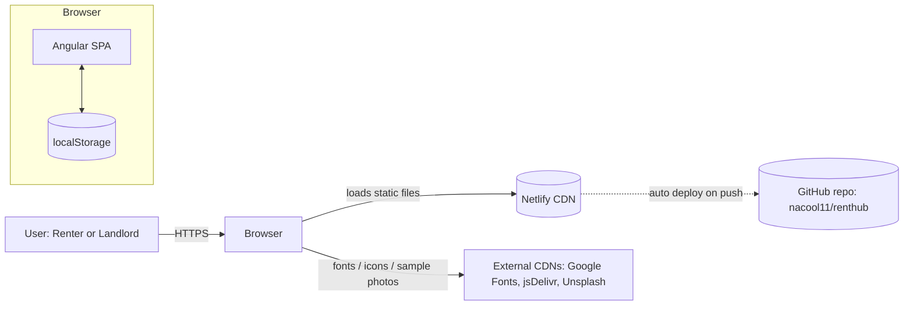
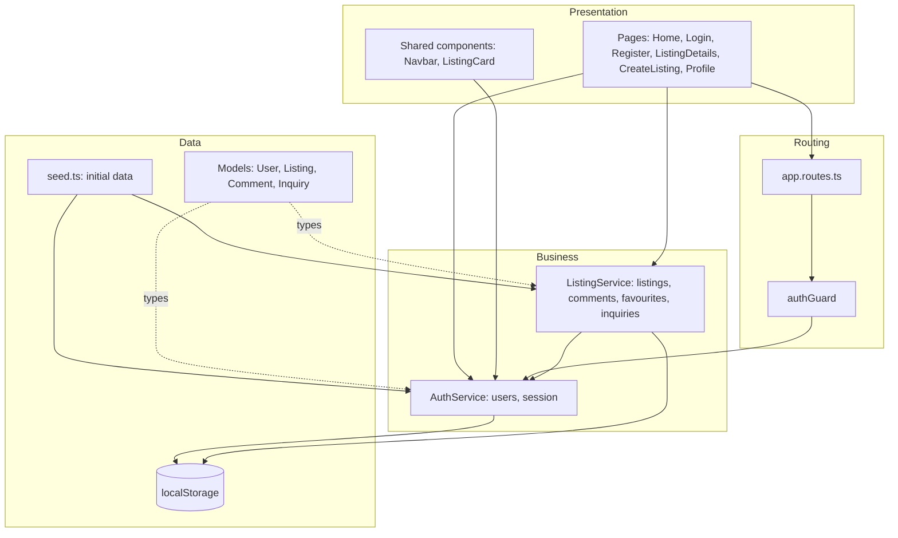
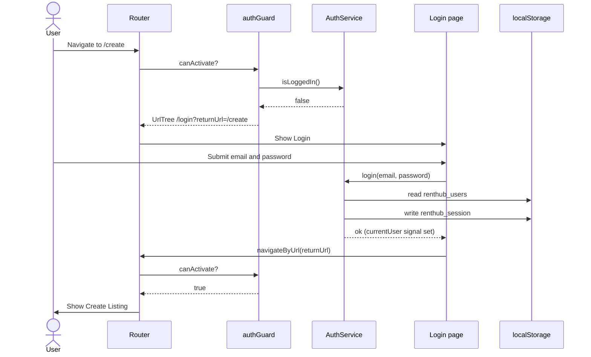
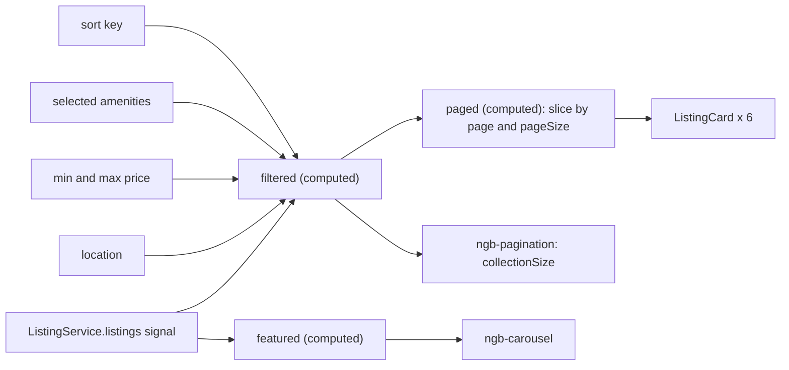
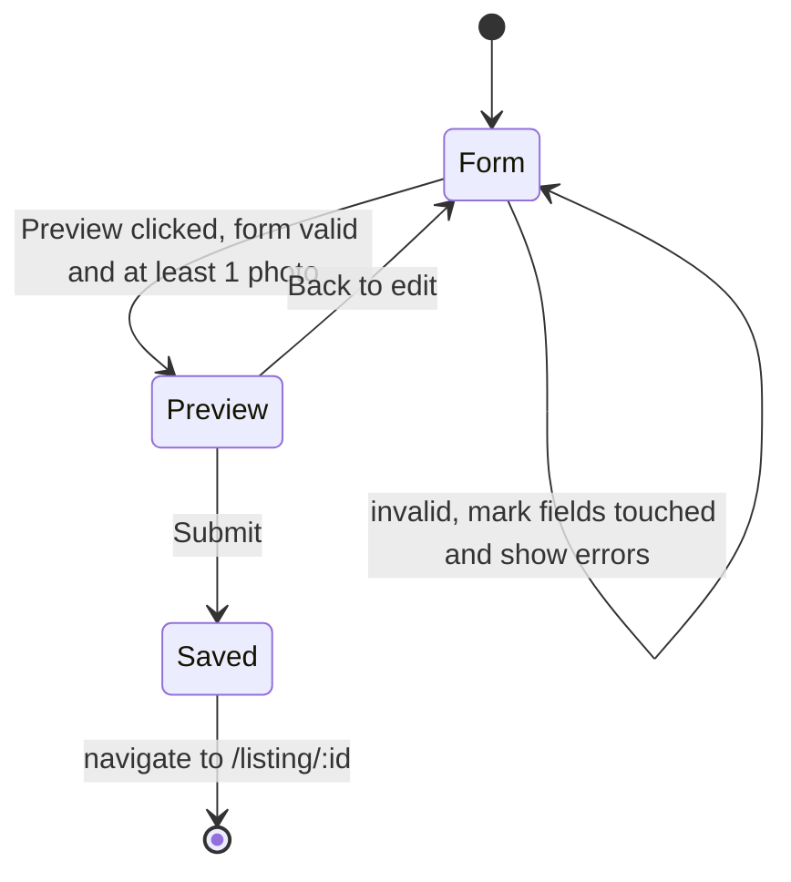
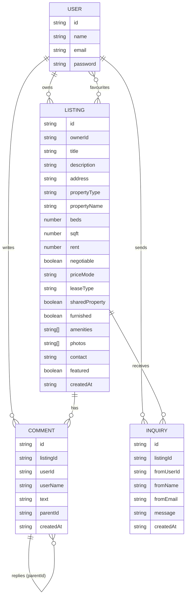
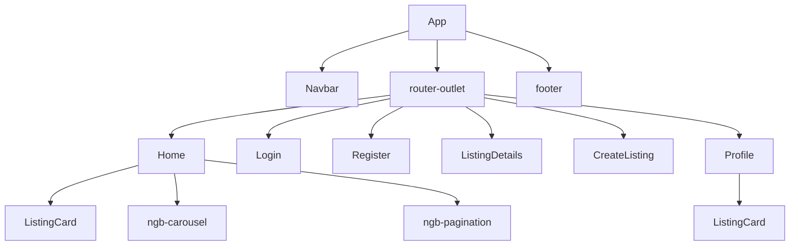
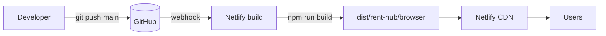

# RentHub: Apartment Rental Platform

An Airbnb-inspired apartment rental web app built with **Angular**, **Bootstrap 5** and **ng-bootstrap**. Landlords post listings, renters save favourites, send inquiries and discuss in comment threads.

|              |                                                                            |
| ------------ | -------------------------------------------------------------------------- |
| **Live app** | [https://renthubnakul.netlify.app/](https://renthubnakul.netlify.app/)     |
| **GitHub**   | [https://github.com/nacool11/renthub](https://github.com/nacool11/renthub) |

---

## Table of contents

1. [Demo credentials](#1-demo-credentials)
2. [Assignment requirement checklist](#2-assignment-requirement-checklist)
3. [Bonus attempted](#3-bonus-attempted)
4. [Features](#4-features)
5. [Tech stack](#5-tech-stack)
6. [High-Level Design (HLD)](#6-high-level-design-hld)
7. [Project structure](#7-project-structure)
8. [Code walkthrough](#8-code-walkthrough)
9. [Form validation reference](#9-form-validation-reference)
10. [Testing](#10-testing)
11. [Run locally](#11-run-locally)
12. [Deployment](#12-deployment)
13. [Design decisions and limitations](#13-design-decisions-and-limitations)
14. [Future improvements](#14-future-improvements)

---

## 1. Demo credentials

| Role                                | Email               | Password    |
| ----------------------------------- | ------------------- | ----------- |
| Renter                              | `demo@renthub.com`  | `Demo@123`  |
| Landlord (owns all seeded listings) | `owner@renthub.com` | `Owner@123` |

You can also register a new account from the **Register** page.

**Suggested tour for evaluators**

1. Browse the home page without logging in (carousel, filters, pagination).
2. Click a heart while logged out. You are redirected to login, then returned.
3. Log in as `demo@renthub.com`, favourite a listing, open its details, post a comment and a reply, send an inquiry.
4. Log in as `owner@renthub.com`, open _Sunny 2BHK in Downtown_, and see the received inquiry. Reply to a comment and use **Edit** and **Delete**.
5. Click **Post a listing**, submit with empty fields to see validation, then fill the form, add photos, review the **Preview and Submit** screen and publish.
6. Open `/create` while logged out to see the auth guard redirect.

---

## 2. Assignment requirement checklist

| Requirement                                                  | Status | Where                                                                      |
| ------------------------------------------------------------ | ------ | -------------------------------------------------------------------------- |
| User registration and login                                  | Done   | `Register`, `Login`, `AuthService`                                         |
| Post apartments (create, update, delete)                     | Done   | `CreateListing` (create and edit), `ListingService`, `Profile`             |
| Show interest: favourites                                    | Done   | Heart and "Mark as Favourite" on cards, carousel and details page          |
| Show interest: inquiries                                     | Done   | "Send inquiry" on details page, owner sees them under "Inquiries received" |
| Comment and reply                                            | Done   | `ListingDetails`: comments with nested replies, Owner badge                |
| Home: carousel plus paginated listings                       | Done   | `ngb-carousel`, `ngb-pagination` (6 per page)                              |
| Sort                                                         | Done   | Newest, price low to high, price high to low                               |
| Search and filter (location, price range, amenities)         | Done   | Pill search bar and amenity chips                                          |
| Quick actions: View Details, Mark as Favourite               | Done   | On every card and every carousel slide                                     |
| Create New Post form (radios, checkboxes, description limit) | Done   | `CreateListing`, 1400-character limit with live counter                    |
| View Details screen with comments                            | Done   | `ListingDetails`                                                           |
| Form validation wherever applicable                          | Done   | See [section 9](#9-form-validation-reference)                              |
| Auth guards                                                  | Done   | `authGuard` on `/create`, `/edit/:id`, `/profile`                          |
| Routing implementation                                       | Done   | Lazy-loaded standalone routes, route params, `returnUrl` redirect          |
| Library for CSS                                              | Done   | Bootstrap 5 and ng-bootstrap, themed through CSS variables                 |
| Unit tests: component, service, module                       | Done   | 12 spec files, 41 tests                                                    |
| Responsive and intuitive design                              | Done   | Mobile-first grid, stacked search bar, scrollable chip row                 |
| Deployed on a free host                                      | Done   | Netlify                                                                    |
| Seed data                                                    | Done   | 2 users, 8 listings, 3 comments                                            |

---

## 3. Bonus attempted

**Preview and Submit screen.** After filling the Create Listing form and pressing _Preview_, the user sees a summary of every field and the photos in card layout, and can go **Back to edit** or **Submit listing**. It is built into the same component and driven by a `step` signal. See `pages/create-listing`.

Additional extras: profile page (my listings and favourites), edit and delete listing, photo upload with client-side compression, owner badge on comments, inquiry inbox for the landlord, seeded demo data.

---

## 4. Features

- **Authentication.** Register, login and logout. The session survives a page refresh.
- **Route protection.** Guarded pages redirect to `/login?returnUrl=...` and return the user after login.
- **Home page.** Featured carousel, search pill (location, min and max price, sort), amenity filter chips, paginated grid and a "no results" state.
- **Listing card.** Photo, favourite heart, title, address, area, price, and View Details and Mark as Favourite buttons.
- **Listing details.** Photo gallery with thumbnails, chips for type, beds, area, furnished, shared and lease type, amenities, price panel, contact, comments and replies, inquiry form.
- **Owner tools.** Edit, delete, and view inquiries on your own listings.
- **Create and edit listing.** Reactive form with radios, checkboxes, number inputs, a textarea with a character counter, multi-photo upload and a preview step.
- **Profile.** Your listings (edit and delete) and your favourites.

---

## 5. Tech stack

| Layer       | Technology                                                                         |
| ----------- | ---------------------------------------------------------------------------------- |
| Framework   | Angular (latest), standalone components, `@if` / `@for` control flow               |
| State       | Angular **Signals** (`signal`, `computed`) in services and components              |
| Forms       | Angular **Reactive Forms** with built-in and custom validators                     |
| Routing     | Angular Router, lazy loading via `loadComponent`, functional `CanActivateFn` guard |
| UI          | Bootstrap 5.3, ng-bootstrap (carousel, pagination), Bootstrap Icons, DM Sans font  |
| Styling     | SCSS and CSS variables (`--rh-*`) for the theme                                    |
| Persistence | Browser `localStorage` (no backend required by the assignment)                     |
| Testing     | Vitest through `ng test`, Angular `TestBed`                                        |
| Hosting     | Netlify, auto-deployed from GitHub                                                 |

---

## 6. High-Level Design (HLD)

### 6.1 System context

RentHub is a **frontend-only single-page application (SPA)**. The browser downloads static files from Netlify. All business logic and data live in the browser: Angular services act as a "mock backend", persisting to `localStorage`.



### 6.2 Layered architecture



**Rules of the design**

- Pages and components never touch `localStorage` directly. They call services.
- Services own the data and expose it as **signals**, so the UI updates automatically when data changes.
- `ListingService` depends on `AuthService` (it needs the current user for ownership and favourites). `AuthService` depends on nothing.
- Routes are lazy-loaded, so each page is a separate JavaScript chunk and the first load stays small.

### 6.3 Routing map

| Path           | Component        | Guard                                              | Purpose                    |
| -------------- | ---------------- | -------------------------------------------------- | -------------------------- |
| `/`            | `Home`           | none                                               | Browse, search, filter     |
| `/login`       | `Login`          | none                                               | Sign in                    |
| `/register`    | `Register`       | none                                               | Create account             |
| `/listing/:id` | `ListingDetails` | none (viewing is public; actions prompt for login) | Details, comments, inquiry |
| `/create`      | `CreateListing`  | `authGuard`                                        | New listing and preview    |
| `/edit/:id`    | `CreateListing`  | `authGuard`                                        | Edit own listing           |
| `/profile`     | `Profile`        | `authGuard`                                        | My listings and favourites |
| `**`           | redirect to `/`  | none                                               | Fallback                   |

### 6.4 Authentication and guard flow



### 6.5 Browse, filter and paginate flow (Home page)



Changing any filter resets the page to 1. All derived lists are `computed()` signals, so there is no manual subscription handling.

### 6.6 Create listing with preview (bonus)



### 6.7 Data model



### 6.8 Storage design

| `localStorage` key   | Content                              | Written by       |
| -------------------- | ------------------------------------ | ---------------- |
| `renthub_users`      | `User[]`                             | `AuthService`    |
| `renthub_session`    | the logged-in `User`                 | `AuthService`    |
| `renthub_listings`   | `Listing[]`                          | `ListingService` |
| `renthub_comments`   | `Comment[]` (replies use `parentId`) | `ListingService` |
| `renthub_favourites` | `Record<userId, listingId[]>`        | `ListingService` |
| `renthub_inquiries`  | `Inquiry[]`                          | `ListingService` |

**Seeding.** On first run (key missing) the services write the data from `data/seed.ts`. Seed users are merged in by email so they always exist. To reset the app, clear the site's local storage in the browser DevTools.

**Photos.** Uploaded images are resized to about 900px wide on a `<canvas>` and stored as JPEG base64 strings, to stay within the roughly 5 MB `localStorage` quota.

### 6.9 Component tree



`ListingCard` is a presentational component. It receives data through `input()` and reports user intent through `output()` (`favouriteToggled`). The parent decides what to do, so the same card is reused on Home and Profile.

### 6.10 Build and deployment pipeline



---

## 7. Project structure

```
rent-hub/
├── angular.json                 # build config (Bootstrap CSS is registered in "styles")
├── package.json
├── public/                      # static assets copied as-is into the build
└── src/
    ├── index.html               # fonts and icon CDN links
    ├── styles.scss              # global theme (CSS variables, buttons, forms, pagination)
    └── app/
        ├── app.ts / app.html    # root component: navbar, router-outlet, footer
        ├── app.config.ts        # providers (router)
        ├── app.routes.ts        # route table with lazy loading and guards
        ├── data/
        │   └── seed.ts          # AMENITIES list, SEED_USERS, SEED_LISTINGS, SEED_COMMENTS
        ├── models/
        │   └── models.ts        # User, Listing, Comment, Inquiry interfaces
        ├── services/
        │   ├── auth.ts          # AuthService
        │   └── listing.ts       # ListingService
        ├── guards/
        │   └── auth-guard.ts    # authGuard (CanActivateFn)
        ├── shared/
        │   ├── truncate-pipe.ts # TruncatePipe
        │   └── shared-module.ts # SharedModule (exports TruncatePipe)
        ├── components/
        │   ├── navbar/          # top bar, changes with login state
        │   └── listing-card/    # reusable card
        └── pages/
            ├── home/
            ├── login/
            ├── register/
            ├── listing-details/
            ├── create-listing/  # create, edit and preview
            └── profile/
```

Each folder with a component also contains its `*.spec.ts` unit test.

---

## 8. Code walkthrough

### 8.1 Core Angular concepts used (and where)

| Concept                | One-line meaning                                                     | Where in this project                                     |
| ---------------------- | -------------------------------------------------------------------- | --------------------------------------------------------- |
| Standalone component   | A component that declares its own `imports`, with no NgModule needed | Every page and component                                  |
| Service and `inject()` | A shared class holding data and logic, injected where needed         | `AuthService`, `ListingService`                           |
| Signal                 | A reactive value. When it changes, the UI that reads it updates      | `currentUser`, `listings`, filters on Home                |
| `computed()`           | A signal derived from other signals, recalculated automatically      | `isLoggedIn`, `filtered`, `paged`, `featured`             |
| `input()` / `output()` | Signal-based parent-to-child data and child-to-parent events         | `ListingCard`                                             |
| Reactive Forms         | Forms defined in TypeScript with validators                          | Login, Register, CreateListing, comment and inquiry boxes |
| Lazy routes            | Page code is downloaded only when visited                            | `loadComponent` in `app.routes.ts`                        |
| Functional guard       | A function that allows or redirects a navigation                     | `authGuard`                                               |

### 8.2 `AuthService` (`services/auth.ts`)

- State: `currentUser` signal (restored from `renthub_session` on startup) and `isLoggedIn` computed.
- `register(name, email, password)`: rejects duplicate emails (case-insensitive), stores the user, starts a session.
- `login(email, password)`: finds a matching user and starts a session, otherwise returns an error message.
- `logout()`: clears the session and sets the signal to `null`.
- Constructor merges `SEED_USERS` into storage.
- Passwords are stored in plain text **only because this is a mock backend**. A real API must hash them server-side.

### 8.3 `ListingService` (`services/listing.ts`)

- State: `listings` signal, a private favourites map, and `favouriteIds` computed (the ids favourited by the current user).
- CRUD: `getById`, `add`, `update`, `remove`. Every change goes through `persistListings`, which updates the signal and `localStorage` together.
- Favourites: `toggleFavourite`, `isFavourite`, stored per user id. Ignored when logged out.
- Comments: `getComments(listingId)`, `addComment(listingId, text, parentId?)`. A reply is a comment with a `parentId`.
- Inquiries: `getInquiries(listingId)`, `addInquiry(listingId, message)`.
- Helpers `read` and `write` wrap JSON parsing in try/catch.

### 8.4 `authGuard` (`guards/auth-guard.ts`)

```ts
export const authGuard: CanActivateFn = (route, state) => {
  const auth = inject(AuthService);
  const router = inject(Router);
  return auth.isLoggedIn()
    ? true
    : router.createUrlTree(['/login'], { queryParams: { returnUrl: state.url } });
};
```

Returning a `UrlTree` is the recommended way to redirect from a guard. The `returnUrl` lets login send the user back where they were heading.

### 8.5 Home page (`pages/home`)

- Filter state is held in signals: `location`, `minPrice`, `maxPrice`, `sort`, `selectedAmenities`, `page`.
- `filtered` applies location (matches address or title), price range and amenities (a listing must contain **all** selected amenities), then sorts.
- `paged` slices `filtered` for the current page. `pageSize` is 6.
- `update()` sets a filter and resets to page 1. `clearFilters()` resets everything.
- `toggleFav()` redirects to login if the user is logged out, otherwise toggles the favourite.

### 8.6 Listing details (`pages/listing-details`)

- Reads `:id` from the route and finds the listing through a `computed`.
- `isOwner` decides whether to show Edit, Delete and the inquiry inbox, or the Send inquiry button.
- Comments are loaded as a flat list. `topLevel` filters comments without `parentId`, and `repliesOf(id)` returns the replies for one comment. One level of nesting is displayed.
- Comment, reply and inquiry boxes are `FormControl`s with required and max/min length validators.
- Visitors who are not logged in are sent to login when they try to comment, favourite or send an inquiry.

### 8.7 Create and edit listing (`pages/create-listing`)

- One component handles three modes: **create** (`/create`), **edit** (`/edit/:id`, pre-filled and ownership-checked) and **preview** (the `step` signal).
- `goPreview()` blocks progress if the form is invalid or no photo is added, and marks all fields as touched so every error appears.
- `submit()` maps the form value to a `Listing` and calls `add` or `update`, then navigates to the details page.
- Photo upload validates file type, limits to 5 images and compresses each one on a canvas before storing.

### 8.8 Theme (`styles.scss`)

Colours, radius and shadows are CSS variables (`--rh-*`, `--bs-*`) so the whole look can be changed in one place. Bootstrap's own CSS is loaded from `angular.json` (`"styles"`), and `styles.scss` overrides its buttons, forms, pagination and carousel indicators to get the Airbnb-style coral accent (`#ff385c`), rounded corners and pill search bar.

---

## 9. Form validation reference

| Form            | Field            | Rules                                                  |
| --------------- | ---------------- | ------------------------------------------------------ |
| Login           | Email            | required, valid email format                           |
|                 | Password         | required, min 6 characters                             |
| Register        | Name             | required, min 2 characters                             |
|                 | Email            | required, valid email, must not already exist          |
|                 | Password         | required, min 6 characters                             |
|                 | Confirm password | required, must match password (custom group validator) |
| Create listing  | Property type    | required                                               |
|                 | Property name    | required, max 80                                       |
|                 | Beds             | required, 0 to 20                                      |
|                 | Shared property  | required (radio)                                       |
|                 | Address          | required, min 5                                        |
|                 | Square feet      | required, 50 to 100000                                 |
|                 | Lease type       | required (radio)                                       |
|                 | Rent             | required, greater than 0                               |
|                 | Furnished        | required (radio)                                       |
|                 | Title            | required, 5 to 100 characters                          |
|                 | Description      | required, 30 to 1400 characters, live counter          |
|                 | Contact          | required, valid email **or** phone number (regex)      |
|                 | Photos           | at least 1, at most 5, images only                     |
| Comment / reply | Text             | required, max 500                                      |
| Inquiry         | Message          | required, 10 to 500 characters                         |

Errors appear after a field is touched, or on all fields when submit is attempted.

---

## 10. Testing

Run: `ng test --watch=false`. Current result: **12 test files, 41 tests, all passing**.

| Spec file                                                | What it covers                                                                                             |
| -------------------------------------------------------- | ---------------------------------------------------------------------------------------------------------- |
| `services/auth.spec.ts`                                  | start logged out, login with seed user, wrong password, register, duplicate email, logout                  |
| `services/listing.spec.ts`                               | seeding, find by id, add (ownership), update, remove, favourites per user, comments and replies, inquiries |
| `guards/auth-guard.spec.ts`                              | redirects to `/login` when logged out, allows access when logged in                                        |
| `shared/shared-module.spec.ts` / `truncate-pipe.spec.ts` | **module** compiles, `TruncatePipe` shortens text                                                          |
| `pages/login/login.spec.ts`                              | **component**: validation, wrong credentials, successful login, invalid submit                             |
| `pages/register/register.spec.ts`                        | creation, password mismatch                                                                                |
| `pages/home/home.spec.ts`                                | creation, first page shows 6 listings, location filter                                                     |
| `pages/create-listing/create-listing.spec.ts`            | creation, empty form invalid, 1400-character limit                                                         |
| `pages/listing-details/listing-details.spec.ts`          | creation, "Listing not found" state                                                                        |
| `components/listing-card/listing-card.spec.ts`           | renders title, emits id when heart is clicked                                                              |
| `components/navbar/navbar.spec.ts`                       | creation, Login and Register links when logged out                                                         |
| `app.spec.ts`                                            | app creation, navbar rendered                                                                              |

---

## 11. Run locally

Requirements: Node.js 20 or newer, and the Angular CLI.

```bash
git clone https://github.com/nacool11/renthub.git
cd renthub
npm install
ng serve            # http://localhost:4200
```

Other commands:

```bash
ng test --watch=false    # unit tests
ng build                 # production build into dist/rent-hub/browser
```

To reset data, open DevTools, go to Application, Local Storage, clear, then refresh.

---

## 12. Deployment

- **Host:** Netlify (free plan), connected to the GitHub repo. Every push to `main` triggers a new build and deploy.
- **Build command:** `npm run build` (or `ng build`)
- **Publish directory:** `dist/rent-hub/browser`
- **SPA routing:** because Angular handles routes in the browser, the host must serve `index.html` for any path, otherwise refreshing on `/listing/l1` returns a 404. This is done with a rewrite rule (`/*  /index.html  200`) in `public/_redirects`.
- **Node version:** if a build fails on Node, set the environment variable `NODE_VERSION=22` in Netlify.

---

## 13. Design decisions and limitations

| Decision                                | Reason                                              | Consequence                                                                                  |
| --------------------------------------- | --------------------------------------------------- | -------------------------------------------------------------------------------------------- |
| No backend, `localStorage` as storage   | The assignment only requires deploying the frontend | Data is per browser and per device. Listings posted by one visitor are not visible to others |
| Services as a mock API                  | Keeps components independent of storage             | A real HTTP API can replace the service internals without changing pages                     |
| Plain-text passwords                    | Mock authentication only                            | Not safe for production. Use a backend with hashed passwords and JWT or sessions             |
| Signals instead of RxJS state           | Simpler, less boilerplate, great fit for this size  | Services would use `HttpClient` and Observables once a backend exists                        |
| Photos stored as compressed base64      | Needed for uploads without a server                 | About 5 MB `localStorage` limit, so 5 photos per listing and 900px width                     |
| Seed images from Unsplash               | Realistic demo content                              | Needs internet. A broken image URL can be swapped in `seed.ts`                               |
| Guards only on create, edit and profile | Browsing and reading should be public               | Actions on public pages (comment, favourite, inquiry) prompt for login in the UI             |

---

## 14. Future improvements

- Real backend (Node/NestJS or Firebase) with JWT auth, hashed passwords and a database.
- Cloud image storage (for example Cloudinary or S3) instead of base64.
- Map view and geolocation search (Google Maps or Leaflet).
- Notifications for new inquiries and replies, plus an inquiry inbox for renters.
- Date-based availability and booking requests.
- Server-side pagination and search for large datasets.
- End-to-end tests (Playwright or Cypress) and CI running `ng test` on every pull request.
- Accessibility audit and dark mode.

---

_Built as the Nagarro Angular assignment (RentHub, L1)._
